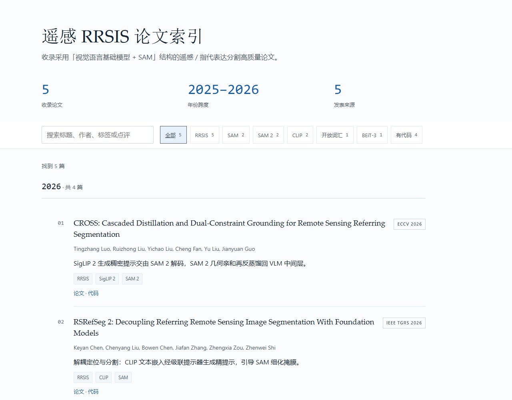
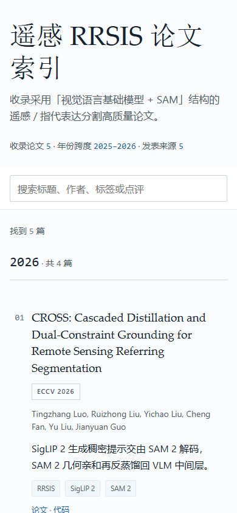

# 遥感 RRSIS 论文索引

收录遥感 / RRSIS 方向采用「视觉语言基础模型 + SAM」结构的高质量论文。

## 在线阅读入口

- **项目主页（GitHub Pages）**：[在线阅读 →](https://sixsheepdad.github.io/Awesome-FM-SAM-for-RRSIS/)
- **仓库源码**：https://github.com/Sixsheepdad/Awesome-FM-SAM-for-RRSIS
- **本地打开**：双击 `index.html`，无需服务器与构建

## 界面预览

| 桌面端 | 移动端 |
| --- | --- |
|  |  |

## 定位与收录范围

只收录**遥感 / RRSIS（Referring Remote Sensing Image Segmentation）方向、且采用「视觉语言基础模型（VLM）+ SAM / SAM2」结构**的高质量论文。通用视觉工作、与遥感无关、或未使用 VLM+SAM 结构的工作一律不收。

判定口径：**VLM 指经图文联合预训练的跨模态模型**（CLIP、BEiT-3、Qwen-VL、LLaVA、Grounding DINO 等）；纯文本编码器（BERT / RoBERTa）、纯视觉骨干（ResNet / RS-VFM）、文生图扩散模型均不计入。SAM 须作为分割骨干实际参与，仅在引言中提及不算。数据集/通用地球观测基础模型若非专门解决 RRSIS，也不收。

## 本地打开

双击 `index.html` 即可查看：纯静态 HTML + CSS + 原生 JS，无构建、无 npm 依赖、不访问外网、无需服务器。

数据以 `<script src="data/papers.js">` 定义 `window.PAPERS`，因此 `file://` 下也能直接读取；**不能用 fetch / XHR 读 JSON**，会被 CORS 拦。同一套文件也直接用于 GitHub Pages，无需构建。

## 数据与展示分离

- `index.html`、`assets/style.css`、`assets/app.js`：展示层，不含任何论文数据。
- `data/papers.js`：数据层，`window.PAPERS.papers` 是唯一数据源，渲染只读这一个数组。

### 字段表

| 字段 | 必填 | 说明 |
| --- | --- | --- |
| `id` | 是 | 唯一稳定字符串 |
| `title` | 是 | 英文论文标题 |
| `authors` | 是 | 字符串数组；超过 6 位显示前 6 + `等` |
| `year` | 是 | 整数 |
| `venue` | 是 | 不含年份的规范简称（CVPR / IEEE TGRS / TPAMI / arXiv），按官方拼写原样输出 |
| `venueType` | 是 | `conference` / `journal` / `preprint`，内部字段，不渲染成可见文本 |
| `tags` | 是 | 字符串数组，**必须全部取自 `tagWhitelist`** |
| `comment` | 是 | 中文一句话点评，≤38 个中文字，讲清如何用 VLM+SAM 结构 |
| `paperUrl` | 是 | `https://` 论文链接；**点击论文标题**或条目底部「论文」均在新标签页打开此地址 |
| `codeUrl` | 否 | `https://` 或 `null`；为 `null` 时显示「代码未公开」 |
| `note` | 否 | 短备注，渲染成 `注 · ` 标签 |
| `demo` | 否 | 仅记录级；示意条目为 `true` |

不设机构（affiliation）字段；作者行只写作者，不写机构、venue 或类型。

## 新增论文

1. 打开 `data/papers.js`。
2. 往 `papers` 数组**最前面**加一条对象即可置顶（按年份倒序分组，组内保持数组原顺序）。
3. 按字段表填齐必填字段；`tags` 只能用 `tagWhitelist` 里已有的标签，确需新标签时先加进 `tagWhitelist`。
4. 保存并刷新 `index.html`。

## 当前收录状态

2026-11-09 已清除全部 `demo` 版式示意条目，现有 **4 篇真实收录**（RSRefSeg、RSRefSeg 2、RS2-SAM2、Training-Free Text-Based RS Segmentation）。演示 banner 由 `papers.some(p => p.demo)` 驱动，无 demo 记录时自动隐藏。

若日后需要临时预览版式，可给条目加 `demo: true`（并填 `note` 说明非真实收录），删掉即恢复；不要为示意条目虚构会议收录或方法结论。

## 发布方式

仓库为 **public**，站点由 GitHub Pages 从 `main` 分支**根目录**发布：<https://sixsheepdad.github.io/Awesome-FM-SAM-for-RRSIS/>。该地址同时填在仓库 **About → Website**，项目页右侧可直接点击进入。

- 仓库文件即站点文件，没有构建步骤；推送到 `main` 后 Pages 自动重建，通常 1–2 分钟生效。
- `README.md` 顶部保留「在线阅读入口」章节，界面截图放在 `docs/screenshots/`；版式调整后需重新截图。
- 站点不访问外网、不加载 CDN，离线双击 `index.html` 与线上 Pages 看到的是同一套内容。
